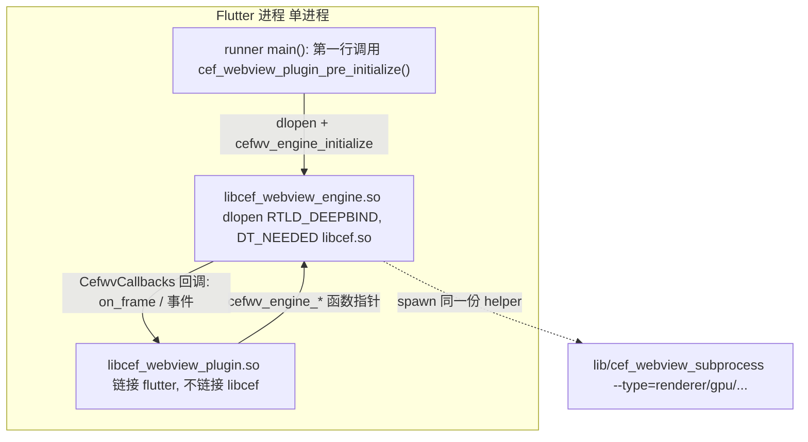
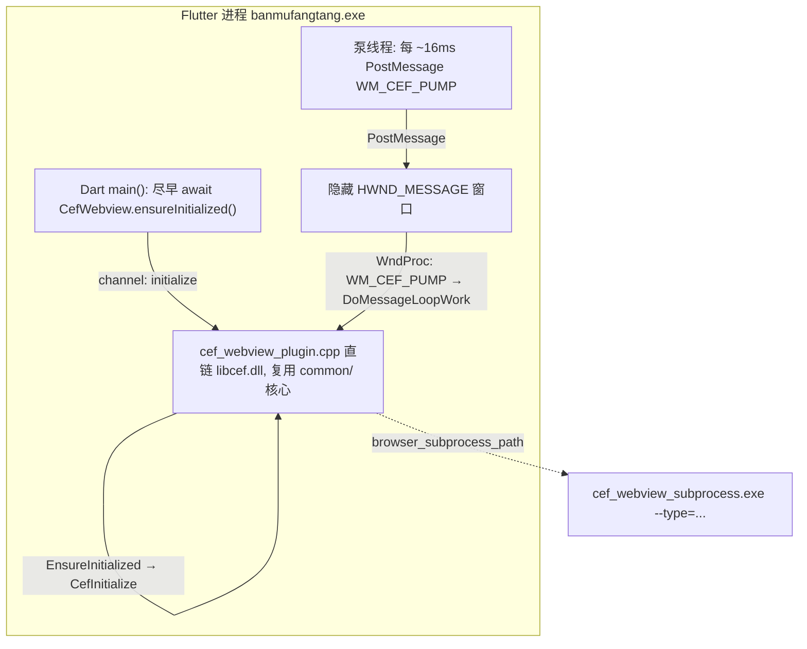
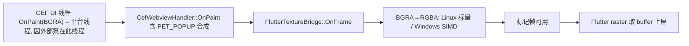
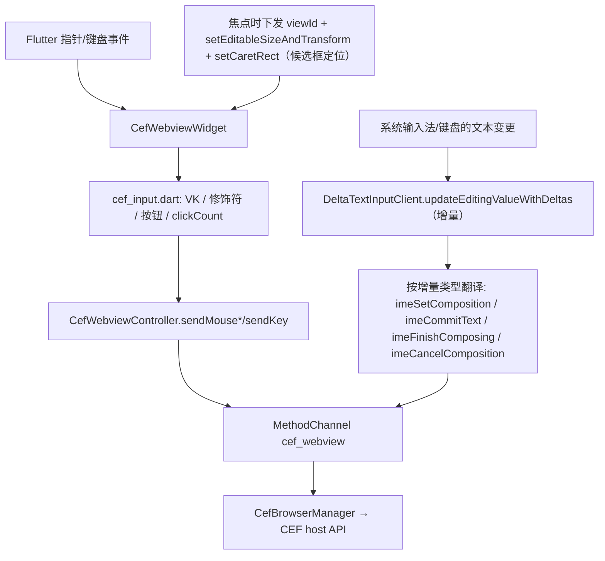

# CEF 集成架构：Linux 与 Windows 实现对照（接手指南）

> 本文面向**接手本插件的下一位开发者 / AI**，讲清楚：插件的分层结构、跨端共享的核心、
> 以及 **Linux 与 Windows 各自是怎么实现的、为什么不一样**。读完即可定位任意改动点。
>
> 配套文档：
> - `README.md` —— 用法、目录、MethodChannel 协议速查
> - `docs/DEVELOPMENT_LOG.md` —— 调试踩坑史与根因（Linux 视角，部分 Windows 结论已被本文更新）
> - `docs/BUILD_CEF.md` —— CEF 144 编译/下载
> - `docs/PACKAGING.md` —— 三端打包分发
> - `docs/LINUX_TROUBLESHOOTING.md` —— Linux 运行排错
>
> CEF 版本：`144.0.29+g0b1a012+chromium-144.0.7559.256`。渲染方案统一为 **OSR 离屏渲染**
> （CEF `OnPaint` 输出 BGRA 帧 → Flutter 外部纹理 `Texture`）。

---

## 1. 三层结构总览

无论哪个平台，代码都分三层；**平台差异只集中在最底下的「平台插件层」**：

```
┌─ Dart 业务层 (lib/) ───────────────────────────────────────── 三端完全共享
│   CefWebview / CefWebviewController / CefWebviewWidget /
│   cef_input.dart / CefLinkInterceptor / CefBrowserWindow
│        │  MethodChannel "cef_webview"（双向）        ▲ Texture(textureId)
├─ 平台插件层 ───────────────────────────── 各端不同（本文重点）
│   Linux : linux/cef_webview_plugin.cc      （GObject + FlPixelBufferTexture + dlopen 引擎）
│   Windows: windows/cef_webview_plugin.cpp   （flutter::Plugin + PixelBufferTexture + 直链 libcef）
│   macOS : macos/Classes/CefMacBridge.mm     （Obj-C++ + CVPixelBuffer，未真机验证）
│        │  调用 ↓                                   ▲ 回调（纹理帧 / 事件）
├─ 跨端 C++ 核心 (common/) ──────────────────────────────────── 三端共享
│   CefBrowserManager / CefWebviewHandler / CefWebviewApp / cef_subprocess_main
│   抽象接口：FlutterTextureBridge、CefEventSink（由各平台插件实现）
└─ CEF 144（libcef） + 独立子进程 cef_webview_subprocess
```

**关键心智模型**：`common/` 里的 C++ 是平台无关的「CEF 操作核心」，它**只认两个抽象接口**——
`FlutterTextureBridge`（把 BGRA 帧交给 Flutter 纹理）和 `CefEventSink`（把事件回传 Dart）。
每个平台插件负责：① 实现这两个接口；② 用本平台方式驱动消息泵；③ 解析 MethodChannel 参数后转调
`CefBrowserManager`。**Linux 与 Windows 的全部区别，都是「怎么接这两个接口 + 怎么初始化/泵消息」。**

---

## 2. 跨端共享层（先读这部分，再看平台差异）

### 2.1 Dart 业务层 `lib/`（三端一字不差）

| 文件 | 职责 |
| --- | --- |
| `src/cef_webview_manager.dart` | `CefWebview`：全局 `ensureInitialized()`、`MethodChannel('cef_webview')` 总线、C++→Dart 回调按 `browserId` 路由到对应 controller |
| `src/cef_webview_controller.dart` | 单浏览器实例控制器：`create`/`createWithHtml`、导航、`evaluateJavascript`、输入转发（`sendMouse*`/`sendKey`/`ime*`）、`handleNativeCall` 收事件。含 `@visibleForTesting CefWebviewController.forTest(...)` 测试工厂 |
| `src/cef_webview_widget.dart` | `Texture` + `Listener`（鼠标/滚轮/触摸板）+ `Focus`（键盘）+ `DeltaTextInputClient`（IME 增量模型）。把 Flutter 输入转成通道调用，**三端一套路径**（IME 细节见 §6） |
| `src/cef_input.dart` | **纯函数转换层**：`windowsKeyCodeFor`（Flutter 逻辑键→Windows VK）、`cefModifiersFor`（→`cef_event_flags_t`）、`cefMouseButtonFor`、`ClickCounter`（双/三击）。被 widget 使用、被单测覆盖 |
| `src/cef_link_interceptor.dart` | 全局链接拦截 + 白名单 |
| `src/cef_browser_window.dart` | 内嵌浏览器独立窗口外壳（地址栏/进度/前后退/错误页） |

> 输入与 IME 的所有「语义→CEF 数值」换算都集中在 `cef_input.dart`，并由
> `test/cef_input_test.dart` + `test/cef_webview_widget_test.dart` 用 mock 通道验证。
> 改键盘/鼠标/IME 转换**先改这里、先看测试**。

### 2.2 `common/` C++ 核心（三端共享）

- **`CefBrowserManager`（单例，`cef_browser_manager.{h,cc}`）** —— CEF 运行时的唯一入口：
  - `InitializeCef`：`CefSettings` 配置 —— `windowless_rendering_enabled=true`、
    `multi_threaded_message_loop=false`、`external_message_pump=false`（**由平台定时器调用 `DoMessageLoopWork` 驱动**）、`no_sandbox=true`。
  - `CreateBrowser`：`CefBrowserHost::CreateBrowserSync`（OSR，`SetAsWindowless`）。
    用原子标志 `g_message_loop_busy` 包住，**防止外部泵在 `CreateBrowserSync` 的嵌套消息循环里重入 `CefDoMessageLoopWork`**（重入会卡死）。
  - 导航 / 输入分发 / IME：`SendMouseMove`、`SendMouseButton`、`SendMouseWheel`（后两者带 `modifiers`，支持拖拽框选与 Ctrl/Shift+滚轮）、`SendKey`、`ImeSetComposition`/`ImeCommitText`/`ImeFinishComposing`/`ImeCancelComposition`、`SetFocus`。
  - `DoMessageLoopWork`：同样有 `g_message_loop_busy` 防重入。
  - `SetScreenOriginProvider` / `GetScreenOrigin`：平台注入「视图原点→屏幕坐标」，供 OSR 的 `GetScreenPoint` 定位。
- **`CefWebviewHandler`（`CefClient`，`cef_webview_handler.{h,cc}`）** —— 单浏览器实例的全部回调：
  - `CefRenderHandler`（OSR）：`GetViewRect`、`GetScreenInfo`、`GetScreenPoint`、
    `OnPaint`（**含 `PET_POPUP` 弹层合成**：把 `<select>` 下拉等弹层叠加到主视图纹理）、`OnImeCompositionRangeChanged`（回报组字光标矩形）。
  - 其余：LifeSpan（创建/关闭/`OnBeforePopup` 拦新窗口）、Load、Display（含 `OnCursorChange`：OSR 无窗口改光标，回传指针类型给 Dart 由 `MouseRegion` 映射 `SystemMouseCursor`）、Request（导航/证书/渲染进程崩溃自恢复）、ContextMenu（屏蔽原生右键）。
  - JS↔C++：`CefMessageRouterBrowserSide`（`cefQuery`）。
- **`CefWebviewApp`（`CefApp`，`cef_webview_app.{h,cc}`）**：
  - `OnBeforeCommandLineProcessing`（仅浏览器进程）：追加 OSR 必需开关
    `disable-gpu` / `disable-gpu-compositing` / `in-process-gpu` / **`enable-begin-frame-scheduling`**（缺它会画几帧后停刷、整窗「无响应」），并透传 Dart 的 `extraCommandLineSwitches`。
  - 渲染进程侧：`OnContextCreated` 注入 `window.cefBridge`（包装 `cefQuery`）+ `CefMessageRouterRendererSide`。
- **`cef_subprocess_main.cc`**：CEF 多进程的 helper 可执行入口（`CefExecuteProcess` + `CefWebviewApp`）。
  必须是**独立可执行**：Flutter 插件在宿主 `main()` 后才加载，无法在最早期调用 `CefExecuteProcess`；复用宿主程序会重启整个 Flutter 引擎导致崩溃。
- **两个抽象接口**（平台插件实现）：
  - `FlutterTextureBridge`：`CreateTexture / OnFrame(BGRA) / ResizeTexture / DisposeTexture`。
  - `CefEventSink`：`OnLoadingStateChange / OnAddressChange / OnTitleChange / OnLoadError / OnJsMessage / OnBeforePopup / OnGlobalError / OnImeCursorRect / OnCursorChange`。

### 2.3 MethodChannel 协议 `cef_webview`（当前完整版）

Dart → C++（`invokeMethod`）：`initialize`、`createBrowser`（返回 `{browserId, textureId}`）、
`loadUrl`/`reload`/`stopLoad`/`goBack`/`goForward`、`resize`、`setVisible`、`setFocus`、
`evaluateJavascript`、`mouseMove`（含 `modifiers`）、`mouseButton`（`button`/`down`/`clickCount`/`modifiers`）、
`mouseWheel`（含 `modifiers`）、`key`（`type`/`windowsKeyCode`/`nativeKeyCode`/`modifiers`/`character`）、
`imeSetComposition`/`imeCommitText`/`imeFinishComposing`/`imeCancelComposition`、
`closeBrowser`、`shutdown`。

C++ → Dart（均带 `browserId`）：`onLoadingStateChange`、`onAddressChange`、`onTitleChange`、
`onLoadError`、`onJsMessage`、`onBeforePopup`、`onImeCursorRect`、`onCursorChange`（指针类型变化）、
`onCefError`（无 browserId）。

> 三端**共用同一套协议字符串**。Linux/Windows/macOS 插件各自解析参数后转调
> `CefBrowserManager` 的同名方法 —— 这就是「核心共享、外壳分平台」的落点。

---

## 3. Linux 是怎么实现的

**一句话**：CEF 被封进一个**独立的 `libcef_webview_engine.so`**，插件用 `dlopen(RTLD_DEEPBIND)`
加载它、通过**纯 C ABI** 调用；插件本身只碰 Flutter、绝不链接 libcef。



要点逐条：

1. **为什么要独立 .so + DEEPBIND**：Flutter 的 `libflutter_linux_gtk.so` 本身基于 Chromium。
   若插件直接链接 `libcef.so`，两套 Chromium 的全局符号/内存分配器会冲突，`CefInitialize` 阶段**死锁**。
   `dlopen(RTLD_NOW|RTLD_LOCAL|RTLD_DEEPBIND)` 让引擎优先解析自身符号，与 Flutter 隔离。
   见 `linux/cef_webview_plugin.cc` 的 `load_engine()`。
2. **C ABI 边界**：`common/cef_engine_api.h` 定义 `cefwv_engine_*` 导出函数 + `CefwvCallbacks` 回调结构体。
   引擎侧实现见 `common/cef_engine_api.cc`（内部把回调适配成 `FlutterTextureBridge`/`CefEventSink` 再转调 `CefBrowserManager`）。
   **引擎绝不触碰任何 Flutter 符号**；所有纹理/通道操作通过回调交还插件执行（回调都在泵消息的平台线程触发，可安全操作 Flutter）。
3. **初始化时机**：`cef_webview_plugin_pre_initialize()` 在 **runner `main()` 最早期、单线程**调用
   （Linux runner 的 `my_application.cc`）。它 `dlopen` 引擎并调 `cefwv_engine_initialize`。
   随后 Dart 的 `initialize` 通道调用只做「检查 `is_initialized` + 启动泵定时器」。
4. **浏览器进程的 CefApp = `nullptr`**：在 DEEPBIND 引擎里实例化含多重继承的 `CefWebviewApp` 会在
   `CefInitialize` 崩溃，所以浏览器进程传 `nullptr`，命令行开关改用 **argv 注入**
   （`cef_engine_api.cc` 的 `BuildMainArgs` 读 `/proc/self/cmdline` 后追加 `--disable-gpu` 等）。
   JS 桥/渲染逻辑由**子进程**的 `CefWebviewApp` 承载。
5. **消息泵**：`g_timeout_add(16ms, pump_cb)` 挂在 GLib 主循环上 → `cefwv_engine_pump()` → `DoMessageLoopWork()`。
6. **纹理**：`CefFlTexture`（`FlPixelBufferTexture` 子类）。`cb_on_frame` 里做 **BGRA→RGBA 标量转换**写入 `pending`，
   `copy_pixels` 时 `swap(pending, stable)`（双缓冲）。**首帧预填一帧透明像素**，否则 Flutter raster 首次 `copy_pixels` 拿到空 buffer 会崩。
7. **子进程**：`lib/cef_webview_subprocess`，靠 `DT_RPATH=$ORIGIN` 找到同目录 libcef.so。
8. **运行约束**：必须在 **ext4** 文件系统运行；CEF 库放 `lib/` 且 `DT_RPATH` 指向它。

---

## 4. Windows 是怎么实现的

**一句话**：插件 `cef_webview_plugin.cpp` **直接链接 libcef**、直接用 `common/CefBrowserManager`，
**没有独立引擎 dll、不需要 DEEPBIND**（Windows 的 Flutter 引擎走 ANGLE/D3D，与 libcef 无符号冲突）。



要点逐条（**与 Linux 的不同之处**用 ★ 标出）：

1. ★ **直接链接，无独立引擎**：`windows/CMakeLists.txt` 让插件链接 libcef，插件直接 `#include "common/cef_browser_manager.h"`
   并调用。没有 `cef_engine_api` 那层 C ABI，也没有 DEEPBIND。
2. ★ **初始化时机 = 懒加载（经 MethodChannel）**：没有 runner-main 预初始化。
   `CefWebviewPlugin::EnsureInitialized`（`cef_webview_plugin.cpp`）由 `initialize` 通道调用触发，
   在**平台线程**上调 `CefBrowserManager::Initialize → CefInitialize`。
   应用侧在 Dart `main()` 里尽早 `await CefWebview.ensureInitialized()`，但本质仍是经通道初始化。
   Windows 能这样是因为**没有 Linux 那种 DEEPBIND 死锁**。
3. ★ **浏览器进程的 CefApp = `CefWebviewApp`**：直接链接下不会崩。**必须传它**，否则
   `OnBeforeCommandLineProcessing` 不被调用 → OSR 的 GPU/逐帧开关全丢 → 页面画几帧后停刷、整窗「无响应」。
   见 `cef_browser_manager.cc` `InitializeCef` 的 `#if !defined(__linux__)` 分支。
4. ★ **消息泵 = 独立线程 PostMessage 自定义消息**：用一条 `std::thread` 每 ~16ms 向隐藏
   `HWND_MESSAGE` 窗口 `PostMessage(WM_CEF_PUMP)`，平台线程在 `WndProc` 里收到后调 `DoMessageLoopWork`。
   **这是替代最初的 `WM_TIMER`**——`WM_TIMER` 是最低优先级、只在队列空闲才投递，繁忙宿主里会被饿死，
   导致渲染子进程连接超时 → `FATAL` 崩溃。自定义 `PostMessage` 不受此限制（等价 Linux 的 `g_timeout_add`）。
5. ★ **纹理 = `flutter::PixelBufferTexture`**（`FlutterDesktopPixelBuffer`），双缓冲 `pending`/`present`。
   `OnFrame` 的 **BGRA→RGBA 用 SSSE3 SIMD（`_mm_shuffle_epi8`，一次 4 像素）**——这是替代标量循环的关键性能修复：
   大窗口 + 持续重绘下，逐像素标量转换（Debug 单帧可达 ~100ms）会占满平台线程导致「未响应」；SIMD 约快一个数量级。
6. ★ **`CreateBrowserSync` 防重入**：单线程消息循环下 `CreateBrowserSync` 内部跑嵌套循环，
   `g_message_loop_busy` 原子标志阻止泵在此期间重入 `CefDoMessageLoopWork`（否则打开页面即整窗无响应）。
7. ★ **`GetScreenPoint` 屏幕原点**：插件在 `EnsureInitialized` 里用 `registrar_->GetView()->GetNativeWindow()`
   → `GetAncestor(GA_ROOT)` → `ClientToScreen` 注册到 `CefBrowserManager::SetScreenOriginProvider`，
   供 handler 的 `GetScreenPoint` 把视图 DIP 坐标换算到屏幕坐标。
8. **子进程**：`cef_webview_subprocess.exe` 与 runner 同目录，CEF 的 dll/资源/语言包平铺在 exe 同目录。
9. **构建注意**：`windows/CMakeLists.txt` 关沙箱（`USE_SANDBOX OFF`，否则 `_ITERATOR_DEBUG_LEVEL`/`LNK2038` 不匹配），
   加 `/utf-8`（中文注释防 C4819）。

---

## 5. Linux vs Windows 一览对照表

| 维度 | Linux | Windows |
| --- | --- | --- |
| CEF 与插件的关系 | 独立 `libcef_webview_engine.so`，`dlopen(RTLD_DEEPBIND)` 加载 | 插件**直接链接** libcef.dll，无独立引擎 |
| 与核心的调用边界 | 纯 C ABI（`cefwv_engine_*` + `CefwvCallbacks`，`cef_engine_api.*`） | 直接 `#include` 调 `CefBrowserManager` |
| 为何如此 | Flutter(GTK) 也是 Chromium，直链 libcef 会符号/分配器冲突→`CefInitialize` 死锁 | Flutter 走 ANGLE/D3D，无此冲突 |
| 初始化时机/位置 | runner `main()` 最早期、单线程 `cef_webview_plugin_pre_initialize()` | 经 `initialize` 通道在平台线程 `EnsureInitialized`（Dart `main` 尽早触发） |
| 浏览器进程 CefApp | `nullptr`（多重继承 CefApp 在 DEEPBIND 引擎会崩）；开关走 **argv 注入** | `CefWebviewApp`（必须，否则 OSR 开关丢失→无响应） |
| 消息泵 | `g_timeout_add(16ms)` → `DoMessageLoopWork` | 独立线程 `PostMessage(WM_CEF_PUMP)` 到 `HWND_MESSAGE` → `DoMessageLoopWork`（替代被饿死的 `WM_TIMER`） |
| 外部纹理 | `CefFlTexture : FlPixelBufferTexture`（flutter_linux） | `flutter::PixelBufferTexture` / `FlutterDesktopPixelBuffer` |
| BGRA→RGBA | 标量逐像素（`cb_on_frame`） | **SSSE3 SIMD `_mm_shuffle_epi8`**（性能修复） |
| 纹理同步 | 双缓冲 `pending`/`stable` + `copy_pixels` swap，首帧预填透明 | 双缓冲 `pending`/`present` + `MarkTextureFrameAvailable` |
| 子进程 | `lib/cef_webview_subprocess`（`DT_RPATH=$ORIGIN`） | `cef_webview_subprocess.exe`（exe 同目录平铺 CEF 库/资源） |
| 输入/IME 通道 | 全套 `cefwv_engine_*` + `on_ime_cursor` 回调 | 全套 `CefBrowserManager` 调用 + 插件 `OnImeCursorRect` 转发 |
| 沙箱 | `no_sandbox`（见 LINUX_TROUBLESHOOTING） | `no_sandbox` + CMake `USE_SANDBOX OFF` |
| 状态 | ✅ 完整跑通 | ✅ 渲染/输入/IME 已跑通（本轮修复） |

---

## 6. 渲染 / 输入 / IME 数据流

**渲染（OnPaint → 上屏）**——两端形状一致，只是纹理实现不同：



**输入与 IME（Dart → CEF）**——按键/鼠标走 `cef_input.dart` 换算；文本/中文组字走 Flutter「增量模型」：



> **IME 三端统一走「增量模型」（接手必读，别回退成全量+重置）**：`CefWebviewWidget` 实现
> `DeltaTextInputClient`，以 `enableDeltaModel: true` 打开输入连接，把引擎下发的每条 `TextEditingDelta`
> （插入 / 替换 / 组字 / 删除）翻译成对应的 CEF IME 调用，**全程不调用 `setEditingState` 回写或重置引擎模型**。
>
> - **为什么不能重置引擎模型**：早期用「全量回调」（`updateEditingValue`）时，为了让回调里的 `value.text`
>   只剩“单段”好提交，会在每次提交后 `setEditingState('')` 把引擎模型清空。这会在系统输入法（微软拼音等）
>   **组字途中打断组字区间**，引擎模型随之错乱、中文被**成倍重复**（`你好`→`你好你好`、`ni`→`nini`）。
>   增量模型只转发“变化”，从根上消除了这种重置；OSR 下文本由 CEF 维护，本地只保留一份镜像供 `delta.apply`。
> - **`viewId` 必带**：Flutter 3.32+ 的 Windows 引擎要求 `setClient` 携带 `viewId`，否则原生侧抛
>   `Could not set client, view ID is null.`，**整条文本输入通道直接失效**（中文组字/上屏全收不到；英文当时只是
>   靠按键旁路才“看起来能用”）。取 `View.of(context).viewId`，与官方 `EditableText` 一致；Linux/macOS 提供它无害。
> - **可见字符不走按键 CHAR**：英文/标点/空格都经增量 → `imeCommitText`；`_onKey` 只转发按键语义
>   （rawKeyDown/keyUp、功能键、快捷键）+ 回车补一个 `char(\r)`。`inputType` 用 `text`（单行），避免回车被引擎
>   当作插入 `\n` 再多发一条增量、与 `_onKey` 的回车处理重复（回车的换行/提交交给网页自行决定）。
> - **三端 embedder 均已实现增量通道**（已核对引擎源码）：Windows `text_input_plugin.cc::SendStateUpdateWithDelta`、
>   Linux `fl_text_input_handler.cc`（`enable_delta_model`/`update_editing_state_with_deltas`）、
>   macOS `FlutterTextInputPlugin.mm`（`_enableDeltaModel`/`updateEditStateWithDelta`）。Linux 下 fcitx/搜狗多为
>   “直接提交”，会以一条非组字插入增量到达 → `imeCommitText`，同样正确。
> - **候选框定位**：焦点打开连接后立即、并随布局/滚动每帧维护 `setEditableSizeAndTransform` + `setCaretRect`
>   （Windows 把候选框贴到光标的关键；`onImeCursorRect` 回调用于精修，Linux 多数不触发）。

---

## 7. 构建与分发（要点）

- **Linux**：`linux/CMakeLists.txt` 产出 ① 插件 `.so`（链 flutter）② 引擎 `libcef_webview_engine.so`（链 libcef）
  ③ `cef_webview_subprocess`。CEF 二进制经 `cmake/DownloadCEF.cmake` 下载 minimal 包或指定 `CEF_ROOT`。
  库装进 `lib/`，`DT_RPATH=$ORIGIN`。
- **Windows**：`windows/CMakeLists.txt` 插件直链 libcef、产出 `cef_webview_subprocess.exe`，
  把 CEF 的 dll/资源/`.pak`/`locales` 拷到 runner 同目录；`USE_SANDBOX OFF` + `/utf-8`。
- 细节见 `docs/BUILD_CEF.md` 与 `docs/PACKAGING.md`。

---

## 8. 接手指南：扩展点与易踩的坑

**想加一个 Dart→原生能力**（例：打印、缩放）：
1. `cef_webview_controller.dart` 加方法 → `_invoke('xxx', {...})`；
2. `cef_browser_manager.{h,cc}` 加 `Xxx(browser_id, ...)`；
3. **三端插件都加分发**：`windows/cef_webview_plugin.cpp`、`linux/cef_webview_plugin.cc`（若改了 `CefBrowserManager` 签名还要同步 `cef_engine_api.{h,cc}` 的 C ABI）、`macos/CefMacBridge.mm`。

**想加一个原生→Dart 事件**：`CefEventSink` 加纯虚（给默认空实现可避免破坏其它端）→ handler 里 `sink_->OnXxx(...)` →
各平台插件 override 后经通道 `InvokeMethod("onXxx", {...})` → `controller.handleNativeCall` 分发。

**易踩的坑（务必记住）**：
- 改 `CefBrowserManager` 方法签名时，**给新增参数加默认值**，否则 Linux(`cef_engine_api.cc`)/macOS 调用点编译失败。
- `DoMessageLoopWork` / `CreateBrowserSync` 的 `g_message_loop_busy` 防重入不可去掉。
- Windows 浏览器进程**必须**传 `CefWebviewApp`；Linux 浏览器进程**必须**传 `nullptr`。两者不能互换。
- OSR 必须带 `enable-begin-frame-scheduling`，否则画几帧就停。
- **IME 走增量模型，永远不要为了“拿单段文本”而 `setEditingState` 重置引擎模型**——会打断系统输入法组字、
  导致中文成倍重复（详见 §6）。文本输入连接必须带 `viewId`。改 IME 先看 `cef_webview_widget.dart` 的
  `updateEditingValueWithDeltas` 与 `test/cef_webview_widget_test.dart`。
- **别给可见字符再补发 KEYEVENT_CHAR**：文本统一走增量 → `imeCommitText`，按键旁路再发 char 会重复插入。
- **CEF 日志别开到 `info`**：`CefInitOptions.logSeverity` 用 `warning`。`info` 会把海量 Chromium 日志写进
  进程 stderr，在 IDE 调试器（F5）下 stderr 经管道转发到「调试控制台」吞吐慢，缓冲填满即阻塞平台线程，表现为
  「进入内嵌网页整窗无响应」；`flutter run` 直连终端控制台吞吐快，故只在调试器里复现（见 `DEVELOPMENT_LOG.md`）。
- 纯 Dart 测试：`flutter test`（`test/cef_input_test.dart` + `test/cef_webview_widget_test.dart`，mock 通道，不依赖真实 CEF）。
  原生改动用 `flutter build windows --debug`（或 example）验证编译。

**当前已知限制 / 后续**：
- macOS 代码就绪、未真机验证。
- 真·系统多窗口需结合 `desktop_multi_window`（见 `PACKAGING.md`）。
- 第三方输入法（非微软拼音）个别组字行为可能仍需现场微调。

---

## 9. 文档索引

| 想了解 | 看 |
| --- | --- |
| 用法 / 目录 / 协议速查 | `README.md` |
| 调试踩坑史 / 根因（Linux 视角） | `docs/DEVELOPMENT_LOG.md` |
| Linux vs Windows 实现对照（本文） | `docs/ARCHITECTURE.md` |
| CEF 144 编译 / 下载 / 裁剪 | `docs/BUILD_CEF.md` |
| 三端打包分发 | `docs/PACKAGING.md` |
| Linux 进程 / 依赖 / 崩溃排查 | `docs/LINUX_TROUBLESHOOTING.md` |
